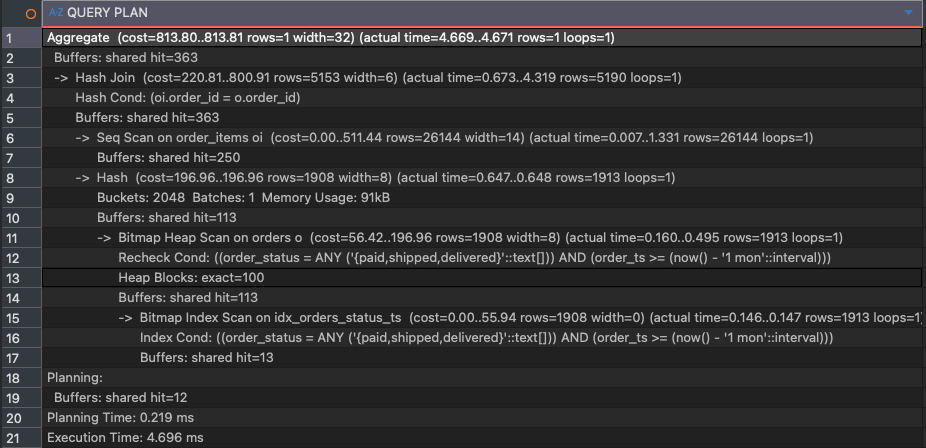
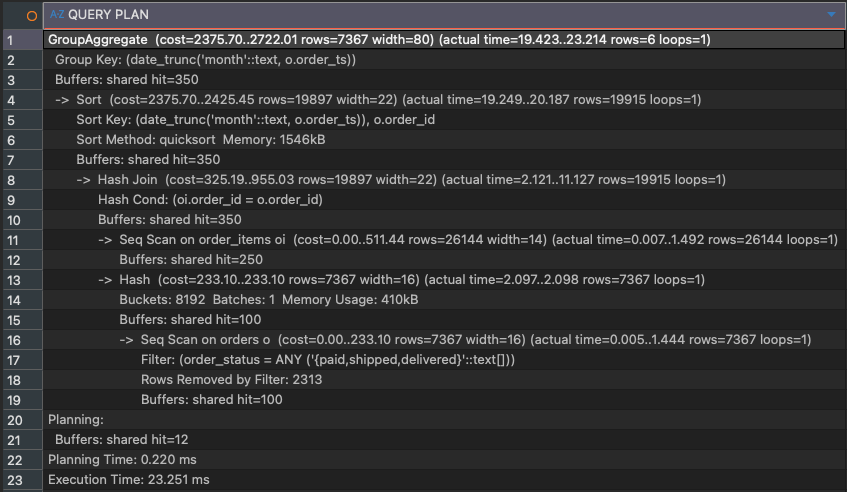
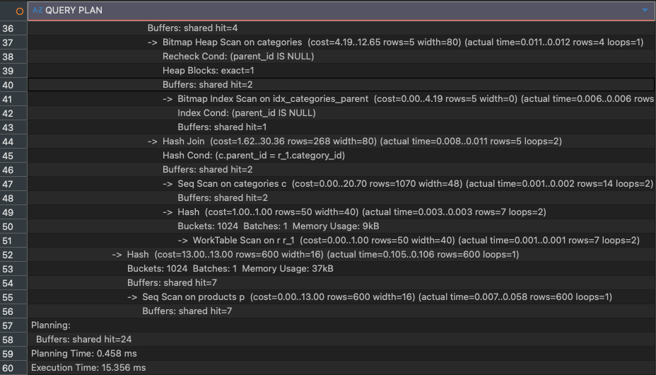
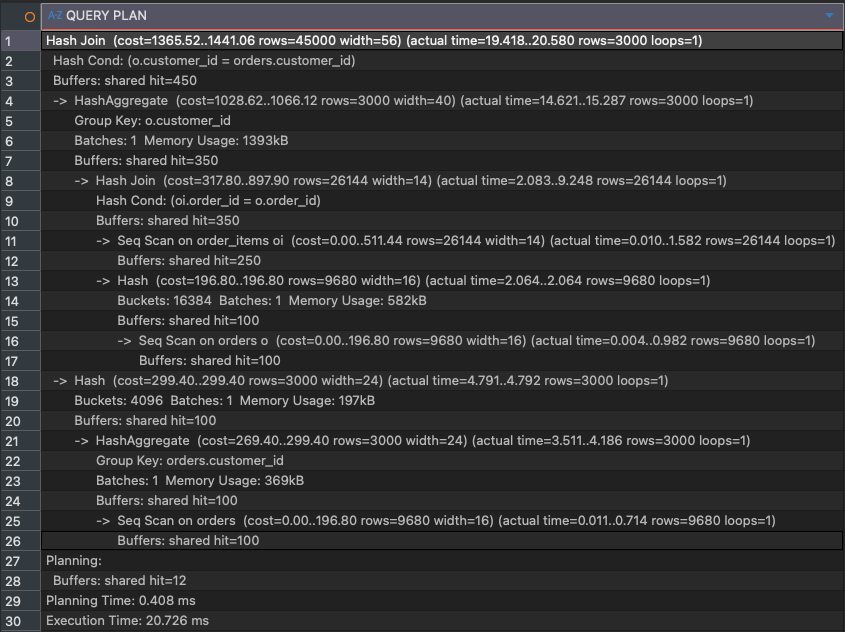
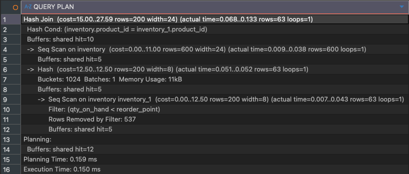
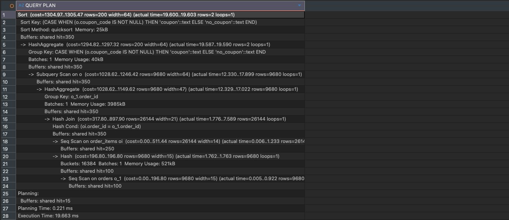
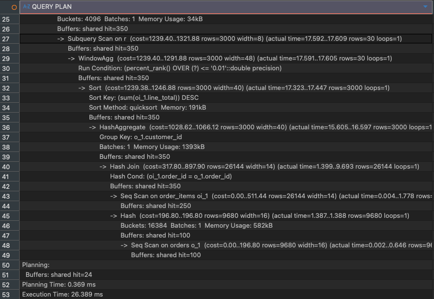
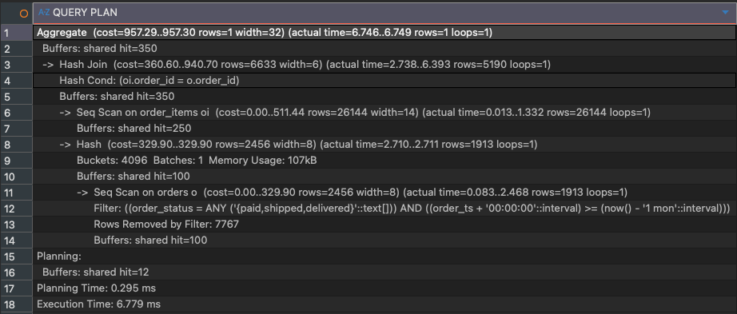
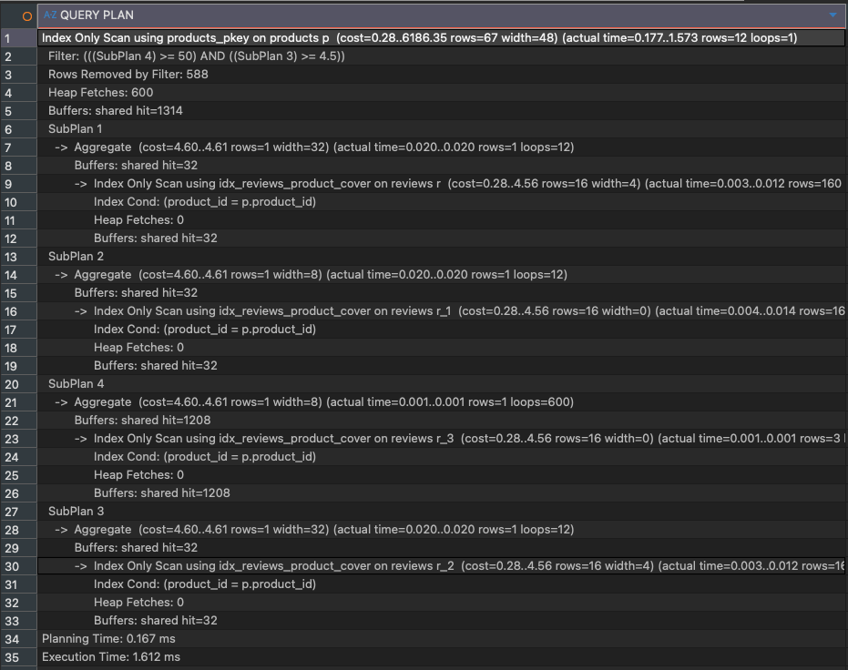
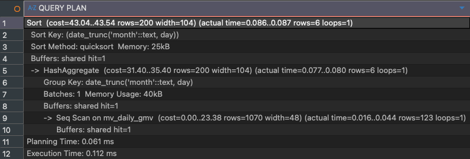

# 종합 실습 4 보고서 — 2~4장 (조인 전략 / Materialized View / 엔진별 옵티마이저)

목차 1번(문항별 튜닝 전·후 쿼리와 결과 화면)은 [report.md](report.md)에 이미 정리되어 있다. 이 문서는 나머지 2~4번 항목 — (2) 3가지 조인에 대한 차이점 정리, (3) Materialized View 생성 스크립트와 실행 후 결과 화면, (4) DBMS 엔진별 옵티마이저 조사 — 을 다룬다. 아래 내용은 실제로 캡처된 `EXPLAIN (ANALYZE, BUFFERS)` 결과([03_queries.sql](../sql/03_queries.sql), `report/screenshot/`)를 근거로 작성했다.

---

## 2. 3가지 조인에 대한 차이점 정리: Hash Join / Nested Loop / Bitmap Heap Scan

먼저 짚어야 할 점: **Hash Join과 Nested Loop Join은 "두 릴레이션을 어떻게 결합할지"를 결정하는 조인 알고리즘**이고, **Bitmap Heap Scan은 "한 테이블에서 행을 어떻게 읽어올지"를 결정하는 스캔(접근) 방식**이다. 성격이 다른 개념이지만, Bitmap Heap Scan은 실제로는 Hash Join·Nested Loop의 입력 쪽에서 자주 함께 등장하기 때문에 실행계획을 읽을 때는 세트로 이해하는 것이 실용적이다.

### 2-1. 개념 정리

| 구분 | 동작 방식 | 유리한 상황 | 불리한 상황 |
|---|---|---|---|
| **Hash Join** | 두 릴레이션 중 작은 쪽으로 해시 테이블을 메모리에 만든 뒤(Hash), 큰 쪽을 한 번 스캔하며 해시 테이블에 프로브(probe) | 동등 조인(equi-join)이고, 조인 키에 쓸만한 인덱스가 없거나 양쪽 다 대용량일 때 | `work_mem`이 부족해 해시 테이블이 여러 배치(Batch)로 나뉘어 디스크를 쓸 때, 비동등 조인일 때 |
| **Nested Loop Join** | 외부(outer) 릴레이션의 각 행마다 내부(inner) 릴레이션을 반복 스캔(또는 인덱스로 탐색) | outer 쪽 행 수가 적고(필터로 크게 좁혀졌고), inner 쪽 조인 키에 인덱스가 있을 때 | outer/inner 모두 행 수가 많고 inner에 인덱스가 없을 때 → 반복 횟수만큼 비용이 곱해짐 |
| **Bitmap Heap Scan** | 인덱스에서 조건에 맞는 힙 페이지 위치들을 먼저 비트맵으로 수집(Bitmap Index Scan)한 뒤, 힙 페이지를 물리적 순서로 방문해 실제 행을 가져옴(필요시 Recheck) | 조건에 맞는 행의 비율이 "적음"과 "대부분"의 중간 정도라 Index Scan(랜덤 I/O 과다)도 Seq Scan(전체 스캔)도 최선이 아닐 때 | 조건에 맞는 행이 거의 없으면 Index Scan이, 대부분이면 Seq Scan이 더 나음 |

### 2-2. 본 실습에서 실제로 관측된 사례

**Hash Join** — `orders`와 `order_items`처럼 조인 키(`order_id`)에 전용 인덱스가 없고 양쪽 다 수천\~수만 행인 동등 조인에서는 튜닝 전/후 가릴 것 없이 항상 Hash Join이 선택되었다.

| 문항 | Hash Cond | 근거 |
|---|---|---|
| Q1 | `oi.order_id = o.order_id` |  |
| Q2 | `oi.order_id = o.order_id` (튜닝 전) |  |
| Q3 | `oi.order_id = o.order_id`, `c.parent_id = r_1.category_id` |  |
| Q5 | `o.customer_id = orders.customer_id` (rf ⋈ monetary) |  |
| Q7 | `inventory.product_id = inventory_1.product_id` (튜닝 전, 자기 자신과 조인) |  |
| Q9 | `oi.order_id = o_1.order_id` |  |
| Q10 | `oi.order_id = o.order_id` |  |

**Bitmap Heap Scan** — 단일 테이블에서 조건에 맞는 행의 비율이 중간 정도일 때 등장했다. 대표적으로 Q1 튜닝 전/후 비교에서 그 역할이 뚜렷하게 드러난다.

- Q1 튜닝 전: `Seq Scan on orders` + `Filter`로 2,456행을 다 읽고서 조건에 안 맞는 것을 걸러냄 (Rows Removed by Filter: 767)
- Q1 튜닝 후: `idx_orders_status_ts` 추가 후 `Bitmap Index Scan on idx_orders_status_ts`로 조건에 맞는 페이지 위치를 먼저 찾고, `Bitmap Heap Scan on orders`로 그 페이지들만 방문 (Heap Blocks: exact=100)
- **중요한 관찰**: 이때도 **상위 조인 방식은 Hash Join 그대로 유지**되었다 — 즉 인덱스 튜닝이 바꾼 것은 "조인 알고리즘"이 아니라 "조인에 넘겨줄 입력 행을 Hash Join에게 더 싸게 공급하는 스캔 방식"이었다. ( → )
- Q3 튜닝 후에도 카테고리 트리의 루트 노드를 찾는 부분에서 `Bitmap Heap Scan on categories` + `Bitmap Index Scan on idx_categories_parent`가 동일한 패턴으로 등장 ()

**Nested Loop Join** — 이번 실습에서 캡처한 20개의 실행계획(Q1~Q10 튜닝 전/후) 전체를 다시 확인한 결과, **명시적인 Nested Loop 노드는 한 건도 관측되지 않았다.**

- **직접적인 이유(쿼리 구조)**: Nested Loop이 나오려면 애초에 outer 쪽 결과가 소수로 좁혀진 뒤 inner 테이블과 PK/인덱스로 다시 조인하는 지점이 쿼리에 있어야 한다. 그런데 Q1~Q10의 조인은 전부 `orders ⋈ order_items`(또는 `products`, `categories`)처럼 양쪽 다 수천\~수만 행인 동등 조인이고, 상위 1% 고객처럼 결과가 극소수로 좁혀지는 Q10조차 `customers` 테이블을 다시 조인하지 않고 `customer_id`와 매출만 반환하도록 작성했다. 즉 "소수 결과 → PK로 재조회"하는 지점 자체가 우리 쿼리들에는 없었다.
- **간접적인 이유(옵티마이저 판단)**: 설사 그런 조인이 있었더라도, `order_items.order_id`에는 조인 전용 단일 인덱스(`idx_order_items_order`)만 있고 outer 쪽 행 수 자체가 충분히 작아지지 않는 한 옵티마이저는 Hash Join을 항상 더 저렴하다고 판단한다.
- Q8처럼 상품마다 리뷰 통계를 반복 조회하는 상관 서브쿼리(before)는 언뜻 "행마다 반복"이라는 점에서 Nested Loop과 비슷해 보이지만, 실제 플랜에서는 `SubPlan`/`InitPlan` 형태로 표시되며 명시적 `Nested Loop` 조인 노드는 아니었다 ().
- **언제 나타나는가**: Q10을 "상위 1% 고객의 customer_id + 이름/이메일까지" 조회하도록 바꿔서 `top_customers`(소수 행)를 `customers` 테이블과 PK로 다시 JOIN하면, outer가 이미 극소수로 좁혀져 있고 inner(`customers`)에 PK 인덱스가 있으므로 Nested Loop Join이 선택될 조건이 된다. 즉 Nested Loop을 관측하지 못한 것은 "데이터가 부족해서"가 아니라 "우리 쿼리가 그런 조인을 요구하지 않아서"이다.

### 2-3. 요약

| | Hash Join | Nested Loop | Bitmap Heap Scan |
|---|---|---|---|
| 분류 | 조인 알고리즘 | 조인 알고리즘 | (단일 테이블) 스캔 방식 |
| 본 실습 관측 여부 | 관측됨 (모든 다중 테이블 조인) | 관측 안 됨 | 관측됨 (인덱스 추가 후 등치+범위 조건 스캔) |
| 관측 안 된 이유 | — | 쿼리에 "소수 결과 → PK 재조회" 지점이 없었음 (Q10이 customers를 조인하지 않음) | — |

---

## 3. Materialized View 생성 스크립트와 실행 후 결과 화면

### 3-1. 생성 스크립트

Q2에서 사용한 `mv_daily_gmv`는 일별 주문수(`order_cnt`)와 매출(`gmv`)을 사전 집계해두는 Materialized View다. (원본 스키마의 `mv_daily_gmv`는 `day`/`gmv`뿐이라 Q2가 요구하는 주문수·AOV까지 커버하도록 재정의했다.)

```sql
DROP MATERIALIZED VIEW IF EXISTS mv_daily_gmv;
CREATE MATERIALIZED VIEW mv_daily_gmv AS
SELECT date_trunc('day', o.order_ts) AS day,
       COUNT(DISTINCT o.order_id) AS order_cnt,
       SUM(oi.line_total) AS gmv
FROM orders o
JOIN order_items oi ON oi.order_id = o.order_id
WHERE o.order_status IN ('paid','shipped','delivered')
GROUP BY 1;
CREATE INDEX IF NOT EXISTS idx_mv_daily_gmv_day ON mv_daily_gmv (day);
```

### 3-2. 리포트 질의 가속 효과 (실측)

Q2 EXPLAIN ANALYZE 캡처를 비교하면 가속 효과가 수치로 확인된다.

| | 실행 계획 요약 | 실행 시간 |
|---|---|---|
| 튜닝 전 (원본 조인) | `orders`(Seq Scan, Filter로 2,313행 제거) ⋈ `order_items`(Seq Scan, 26,144행) → Hash Join → Sort → GroupAggregate | **23.251 ms** |
| 튜닝 후 (MV 스캔) | `mv_daily_gmv`(Seq Scan, 123행) → HashAggregate → Sort | **0.112 ms** |

→ 약 **207배** 실행 시간 단축 (23.251ms → 0.112ms). 원본 조인이 매번 26,144행짜리 `order_items`를 스캔해야 했던 것에 비해, MV는 이미 하루 단위로 집계된 123행만 스캔하면 되기 때문이다.

| 구분 | 스크린샷 |
|---|---|
| 튜닝 전 EXPLAIN ANALYZE |  |
| 튜닝 후 EXPLAIN ANALYZE |  |

### 3-3. 갱신(REFRESH) 전략 검토

Materialized View는 스냅샷이라 원본 데이터(`orders`, `order_items`)가 바뀌어도 자동으로 최신화되지 않는다는 트레이드오프가 있다. 요구사항(오후 3시 기준 갱신)에 맞춰 다음과 같이 설계한다.

- **주기**: 매일 15:00 1회 `REFRESH MATERIALIZED VIEW CONCURRENTLY mv_daily_gmv;` 실행
  - `CONCURRENTLY` 옵션을 쓰면 갱신 중에도 기존 데이터로 조회가 계속 가능(락 없이 갱신)하지만, 대상 뷰에 **UNIQUE 인덱스가 반드시 있어야** 하므로 `day` 컬럼에 `CREATE UNIQUE INDEX`를 추가해야 한다.
- **시점 선택 이유**: 오전 중 발생한 당일 주문·취소·환불 처리가 오후 3시경 대부분 반영된다고 가정, 하루 한 번의 갱신으로 "리포트용 데이터 최신성"과 "조회 성능" 사이를 절충한다. 실시간성이 필요 없는 일별/월별 리포트(Q2)이므로 하루 1회 갱신으로 충분하다.
- **자동화 수단**: `pg_cron` 확장을 이용해 `SELECT cron.schedule('refresh_mv_daily_gmv', '0 15 * * *', 'REFRESH MATERIALIZED VIEW CONCURRENTLY mv_daily_gmv');`로 스케줄링하거나, Airflow 등 외부 스케줄러에서 동일 SQL을 실행하도록 등록한다.
- **한계**: 갱신 주기 동안(최대 24시간) 최신 주문이 리포트에 반영되지 않는다. "당일 실시간 매출"처럼 최신성이 중요한 요구(Q1)에는 MV 대신 인덱스 튜닝(Q1 방식)을 쓰고, "월별 트렌드"처럼 약간의 지연이 허용되는 리포트(Q2)에만 MV를 적용하는 것이 적절하다.

| 구분 | 스크린샷 |
|---|---|
| MV 생성 스크립트 실행 화면 |  |
| MV 조회 결과 화면 (`SELECT * FROM mv_daily_gmv ORDER BY day LIMIT 10;`) |  |
| REFRESH 실행 화면 (선택) |  |

*(위 3개는 아직 캡처가 없어 자리만 비워둔 상태입니다. `report/screenshot/` 폴더에 위 파일명 그대로 저장하면 자동으로 표시됩니다.)*

---

## 4. DBMS 엔진별 옵티마이저 조사 (Postgres / MySQL / Oracle / SQL Server)

| 항목 | PostgreSQL | MySQL (InnoDB) | Oracle | SQL Server |
|---|---|---|---|---|
| 옵티마이저 유형 | Cost-Based Optimizer (CBO) | CBO | CBO (통계 기반 + 적응형 최적화) | CBO |
| 통계 수집 | `ANALYZE` / autovacuum가 자동 실행 | `ANALYZE TABLE`, 8.0+ 히스토그램 지원 | `DBMS_STATS` 자동 잡(기본 활성화) | 자동 통계 업데이트(기본 활성화) |
| 지원 조인 알고리즘 | Nested Loop / Hash Join / Merge Join | 주로 Block Nested Loop, 8.0.18+부터 Hash Join 지원 | Nested Loop / Hash Join / Sort-Merge Join + 파티션와이즈 조인 | Nested Loop / Hash Join / Merge Join |
| 실행계획 확인 | `EXPLAIN (ANALYZE, BUFFERS)`, `EXPLAIN (FORMAT JSON)` | `EXPLAIN`, `EXPLAIN ANALYZE`(8.0.18+), `EXPLAIN FORMAT=JSON` | `EXPLAIN PLAN FOR` + `DBMS_XPLAN.DISPLAY`, SQL Trace | `SET STATISTICS PROFILE/IO/TIME ON`, Actual Execution Plan(그래픽) |
| 옵티마이저 힌트 | 공식 힌트 없음(철학적으로 지양), `pg_hint_plan` 확장으로 우회 가능 | `/*+ ... */` 옵티마이저 힌트 공식 지원(5.7+) | `/*+ ... */` 힌트가 매우 풍부하고 세밀하게 제어 가능 | `OPTION (...)` 쿼리 힌트, `LOOP JOIN` 등 조인 힌트 지원 |
| Materialized View | 수동/스케줄 `REFRESH` 필요(자동 쿼리 재작성 없음) | 공식 미지원(트리거/이벤트 스케줄러로 흉내) | Materialized View + **Query Rewrite** 자동 지원(원본 쿼리를 옵티마이저가 자동으로 MV로 치환) | Indexed View(제약 조건이 까다로움)로 유사 기능 제공 |
| 플랜 캐싱 | Prepared Statement 캐싱, 5회 이후 제네릭/커스텀 플랜 중 유리한 쪽 자동 선택 | 8.0부터 쿼리 캐시 제거, 매번 재수립이 기본 | Shared Pool에 커서 캐싱, Bind Peeking으로 파라미터 값 기반 최적화 | Plan Cache 사용, Parameter Sniffing 이슈 존재(첫 실행 파라미터로 플랜 고정) |

**본 실습과의 연결점**

- 이번 실습은 PostgreSQL 기준으로 진행했지만, "조인 키에 인덱스가 없는 대용량 동등 조인 → Hash Join 선택"이라는 패턴(2절)은 MySQL 8.0.18+/Oracle/SQL Server에서도 유사하게 나타난다.
- 다만 Oracle은 Materialized View에 대해 옵티마이저가 원본 쿼리를 자동으로 MV로 치환해주는 **Query Rewrite** 기능이 있어, Q2처럼 사람이 직접 쿼리를 `mv_daily_gmv` 참조로 바꿔주지 않아도 되는 차이가 있다. PostgreSQL은 이 자동 치환 기능이 없어 애플리케이션/쿼리 단에서 명시적으로 MV를 참조하도록 바꿔야 한다.
- MySQL은 8.0.18 이전까지 Hash Join을 지원하지 않아 `order_items` 같은 대용량 동등 조인에서도 Block Nested Loop을 강제로 써야 했던 버전 차이가 있다 — 즉 동일한 쿼리·데이터라도 MySQL 버전에 따라 이번 실습에서 관측한 것과 다른(더 느린) 조인 전략이 선택될 수 있다.
