# 종합실습 4 : E-Commerce 매출 분석 및 성능 튜닝

- 스키마: `ecom` (01_schema.sql + 02_seed.sql 실행 후 사용)
- 각 문항은 4단계로 구성: ① 튜닝 전 결과 확인 → ② 튜닝 전 성능 측정(EXPLAIN ANALYZE) → ③ 튜닝 후 결과 확인(①과 값 동일해야 정상) → ④ 튜닝 후 성능 측정(EXPLAIN ANALYZE)

---

## Q1) 지난 한 달간 실제 팔린 총 금액 (paid+shipped+delivered)

**쿼리 의도**: `orders`와 `order_items`를 조인해 최근 1개월간 paid/shipped/delivered 상태인 주문의 매출 합계를 구한다.

**튜닝 전 문제점**
`WHERE (o.order_ts + INTERVAL '0 seconds') >= now() - INTERVAL '1 month'`처럼 인덱스 대상 컬럼(`order_ts`)에 연산을 걸어 비교했다. 컬럼에 연산이 붙으면 옵티마이저가 인덱스의 Index Cond로 활용하지 못하고 Seq Scan 후 Filter로 처리하게 된다.

**튜닝 내용**
- `CREATE INDEX idx_orders_status_ts ON orders (order_status, order_ts)` 복합 인덱스 추가
- WHERE 절을 `o.order_ts >= now() - INTERVAL '1 month'`로 되돌려 컬럼을 연산 없이 원본 그대로 비교

**효과**: `order_status` 등치 조건과 `order_ts` 범위 조건이 함께 Index Cond로 결합되어 Index Scan(혹은 Bitmap Index Scan)으로 전환, 스캔 대상 행 수가 크게 감소.

| 구분 | 스크린샷 |
|---|---|
| 결과 확인 (튜닝 전/후 공통) | 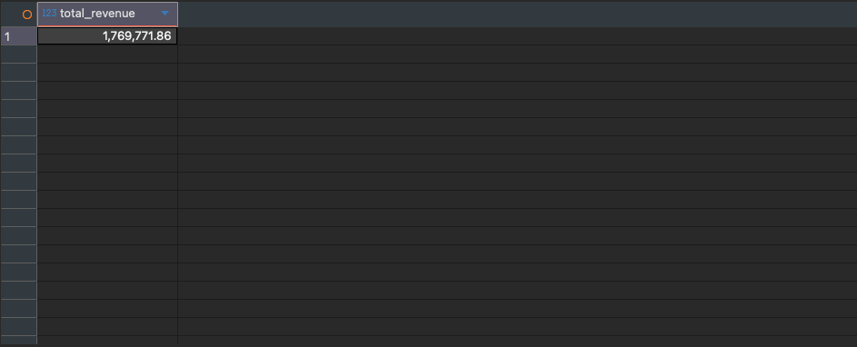 |
| 튜닝 전 EXPLAIN ANALYZE |  |
| 튜닝 후 EXPLAIN ANALYZE |  |

---

## Q2) 월별 주문수 / 매출 / 평균주문금액 (AOV)

**쿼리 의도**: 월 단위로 주문 건수, 총 매출, 주문당 평균 금액(AOV)을 집계하는 리포트 쿼리.

**튜닝 전 문제점**
리포트성 조회임에도 조회할 때마다 `orders ⋈ order_items` 전체를 조인하고 `GROUP BY`로 집계한다. 원본 테이블이 커질수록 매번 무거운 조인·집계 비용을 반복해서 지불하게 된다.

**튜닝 내용**
- `mv_daily_gmv` Materialized View를 일별 `order_cnt`/`gmv`까지 포함하도록 재정의
- `idx_mv_daily_gmv_day` 인덱스 추가
- 조회 쿼리는 원본 테이블 조인 없이 `mv_daily_gmv`만 스캔해서 월 단위로 재집계(`SUM(order_cnt)`, `SUM(gmv)`)

**효과**: 무거운 조인·집계 비용을 MV 갱신(refresh) 시점에 미리 지불해두고, 반복되는 리포트 조회는 훨씬 작은 사전집계 테이블만 스캔하면 되므로 응답 속도가 크게 개선된다. (단, MV는 refresh 전까지는 최신 데이터를 반영하지 못하므로 최신성과 조회속도 사이의 트레이드오프가 존재 — 갱신 주기 설계가 필요)

| 구분 | 스크린샷 |
|---|---|
| 결과 확인 (튜닝 전/후 공통) | 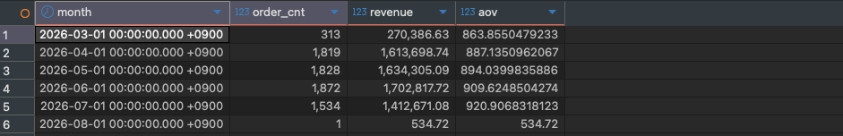 |
| 튜닝 전 EXPLAIN ANALYZE |  |
| 튜닝 후 EXPLAIN ANALYZE |  |

---

## Q3) 최근 90일 카테고리 Top10

**쿼리 의도**: 최근 90일간 카테고리별 매출을 집계해 상위 10개 카테고리를 조회.

**튜닝 전 문제점**
Q1과 동일하게 `(o.order_ts + INTERVAL '0 seconds') >= now() - INTERVAL '90 days'` 형태로 컬럼에 연산을 걸어 인덱스를 활용하지 못한다.

**튜닝 내용**
- 별도 인덱스를 새로 만들지 않고, Q1에서 생성한 `idx_orders_status_ts`를 그대로 재사용
- WHERE 절 비교를 `o.order_ts >= now() - INTERVAL '90 days'`로 원본 컬럼 비교로 되돌림

**효과**: 여러 쿼리가 동일한 필터 패턴(`order_status` + `order_ts` 범위)을 공유한다면, 인덱스 하나로 여러 쿼리를 함께 커버할 수 있음을 보여준다 — 인덱스 설계 시 재사용성을 고려해야 하는 사례.

*참고: 현재 카테고리 트리는 리프 카테고리가 10개뿐이라 Top10 결과가 전체 카테고리와 같을 수 있음(정상).*

| 구분 | 스크린샷 |
|---|---|
| 결과 확인 (튜닝 전/후 공통) | 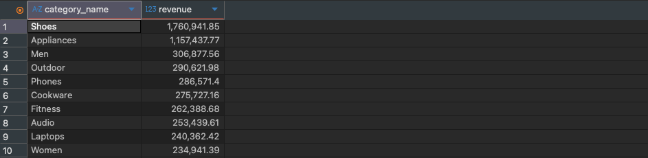 |
| 튜닝 전 EXPLAIN ANALYZE | 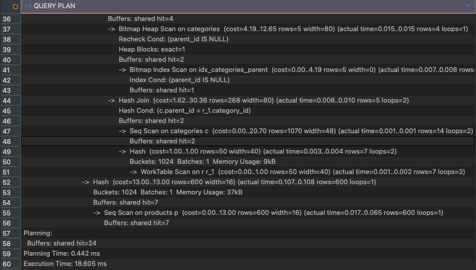 |
| 튜닝 후 EXPLAIN ANALYZE |  |

---

## Q4) 제품별 누적매출 RANK() Top20

**쿼리 의도**: 제품별 누적 매출을 구하고, 매출 기준 순위를 매겨 상위 20개 제품을 조회.

**튜닝 전 문제점**
"나보다 매출이 큰 제품 수 + 1"을 구하는 상관 서브쿼리(correlated subquery)로 순위를 흉내 냈다. 제품마다 전체 제품 집계 결과를 다시 스캔하므로, 제품 수가 N개면 사실상 O(N²)에 가까운 반복 스캔이 발생한다.

**튜닝 내용**
- `RANK() OVER (ORDER BY SUM(line_total) DESC)` 윈도우 함수로 대체해 단일 스캔+정렬로 순위를 계산
- `CREATE INDEX idx_order_items_product_cover ON order_items (product_id) INCLUDE (line_total)` 커버링 인덱스 추가

**효과**: O(N²) 상관 서브쿼리 → 단일 스캔·정렬(O(N log N))로 전환되고, 커버링 인덱스 덕분에 Index Only Scan이 가능해져 힙 접근(Heap Fetch)이 제거된다.

| 구분 | 스크린샷 |
|---|---|
| 결과 확인 (튜닝 전/후 공통) | 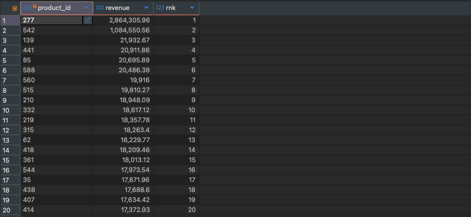 |
| 튜닝 전 EXPLAIN ANALYZE | 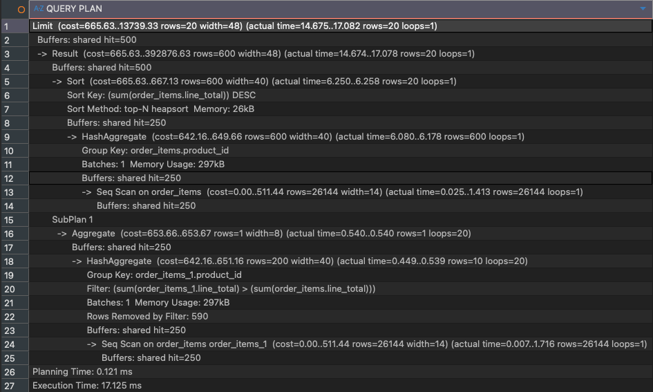 |
| 튜닝 후 EXPLAIN ANALYZE | 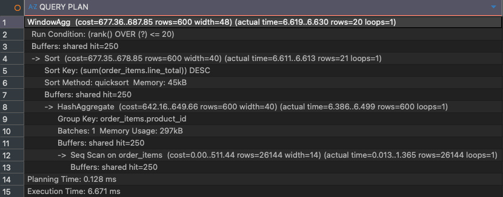 |

---

## Q5) RFM (최근성 / 빈도 / 금액)

**쿼리 의도**: 고객별로 최근 구매 시점(Recency), 구매 빈도(Frequency), 총 구매 금액(Monetary)을 구한다.

**튜닝 전 문제점**
`orders`와 `order_items`를 통째로 조인한 뒤 고객별로 집계했다. `order_items`가 `orders`에 대해 1:N 관계이므로 조인 결과가 fan-out되어, 주문 단위 지표인 recency/frequency까지 부풀려진 행 위에서 계산되고, 이를 바로잡기 위해 `COUNT(DISTINCT o.order_id)`로 억지로 중복을 제거해야 했다.

**튜닝 내용**
- recency/frequency는 `orders` 테이블만으로 먼저 집계(`WITH rf`)
- monetary(금액)는 `order_items`와 조인해 별도로 집계(`WITH monetary`)
- 마지막에 고객 단위로 두 결과를 병합

**효과**: fan-out된 결과 위에서 집계하지 않으므로 중간 결과 행 수가 감소하고, `DISTINCT`로 중복을 걷어내는 우회가 필요 없어진다.

| 구분 | 스크린샷 |
|---|---|
| 결과 확인 (튜닝 전/후 공통) | 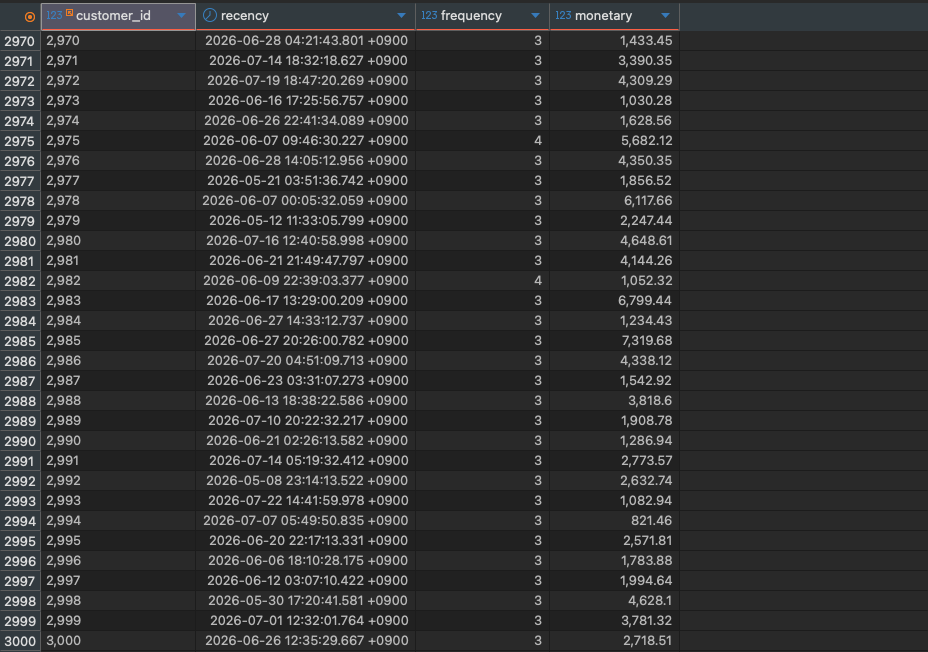 |
| 튜닝 전 EXPLAIN ANALYZE | 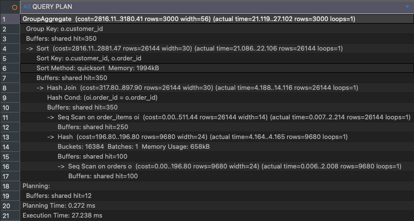 |
| 튜닝 후 EXPLAIN ANALYZE |  |

---

## Q6) 첫 구매 후 30일 내 재구매율

**쿼리 의도**: 고객의 첫 주문 시각을 기준으로, 30일 이내에 두 번째 주문이 발생한 비율을 계산.

**튜닝 전 문제점**
고객마다 "첫 주문 이후 최소 주문 시각(다음 주문)"을 구하는 상관 서브쿼리를 반복 실행했다. 고객 수만큼 `orders`를 반복 스캔하는 N+1 패턴이다.

**튜닝 내용**
- `LEAD(order_ts) OVER (PARTITION BY customer_id ORDER BY order_ts)` 윈도우 함수로 고객별 다음 주문 시각을 한 번의 스캔으로 계산
- `ROW_NUMBER() = 1`(첫 주문)인 행만 남겨 재구매 여부 판정

**효과**: 반복되는 상관 서브쿼리 스캔이 제거되고, `(customer_id, order_ts)` 인덱스가 있으면 정렬된 스캔 한 번으로 처리 가능해진다.

| 구분 | 스크린샷 |
|---|---|
| 결과 확인 (튜닝 전/후 공통) | 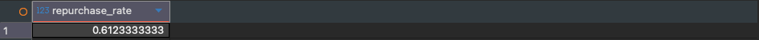 |
| 튜닝 전 EXPLAIN ANALYZE | 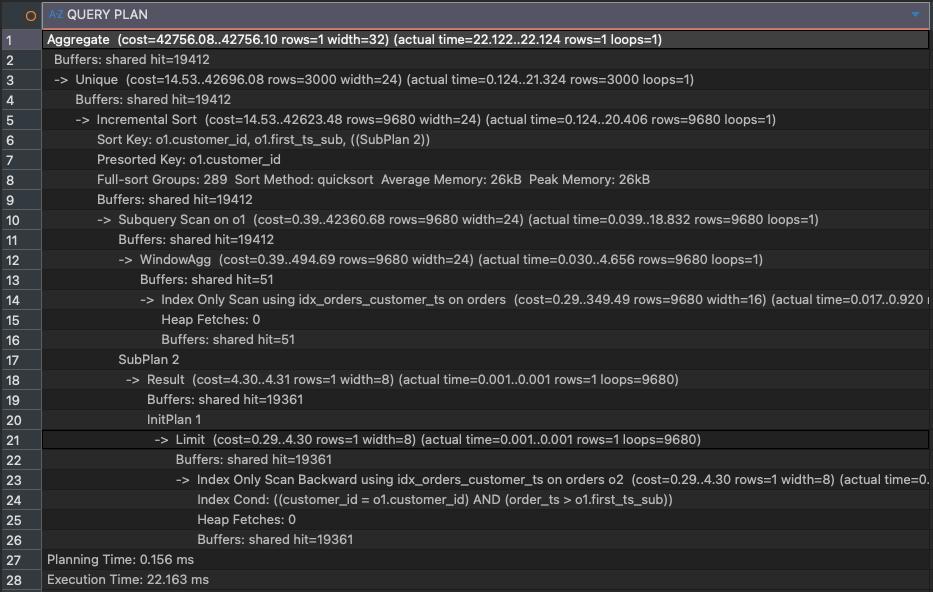 |
| 튜닝 후 EXPLAIN ANALYZE | 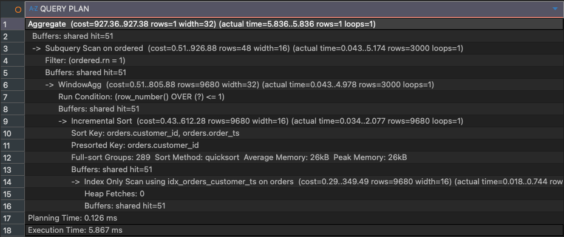 |

---

## Q7) 재고 임계치 미달 상품

**쿼리 의도**: 현재 재고 수량(`qty_on_hand`)이 재주문 임계치(`reorder_point`)보다 낮은, 곧 품절될 위험이 있는 상품을 조회.

**튜닝 전 문제점**
`WHERE product_id IN (SELECT product_id FROM inventory WHERE qty_on_hand < reorder_point)`처럼 같은 테이블(`inventory`)을 자기 자신에 대한 서브쿼리로 감싸, 불필요하게 두 번 스캔했다.

**튜닝 내용**
- 서브쿼리를 제거하고 `WHERE qty_on_hand < reorder_point` 조건을 직접 적용

**효과**: 테이블 스캔이 1회로 감소한다.

*참고: `inventory`가 약 600행 정도의 소규모 테이블이라, 인덱스를 추가해도 옵티마이저가 여전히 Seq Scan을 선택할 수 있다. 이는 소규모 테이블에서 인덱스 스캔보다 Seq Scan이 더 저렴하게 판단된 정상적인 선택이다.*

| 구분 | 스크린샷 |
|---|---|
| 결과 확인 (튜닝 전/후 공통) | 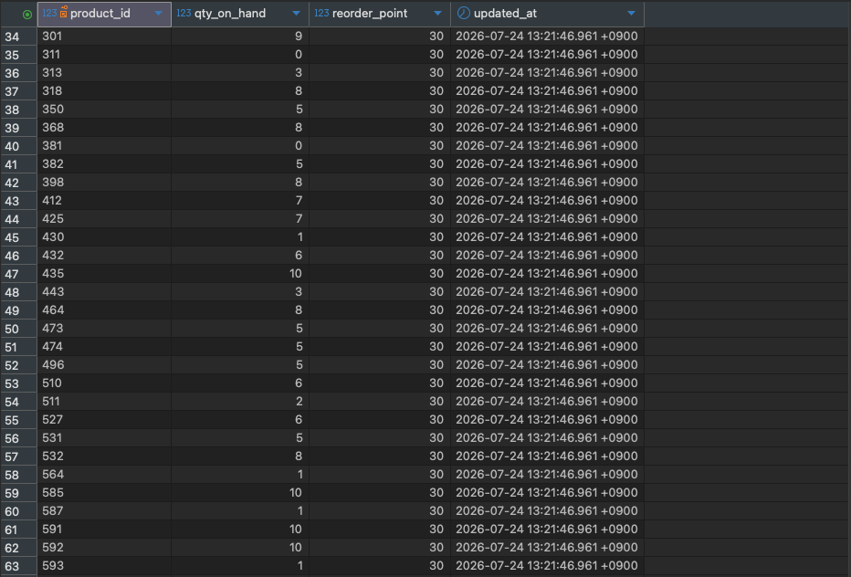 |
| 튜닝 전 EXPLAIN ANALYZE |  |
| 튜닝 후 EXPLAIN ANALYZE | 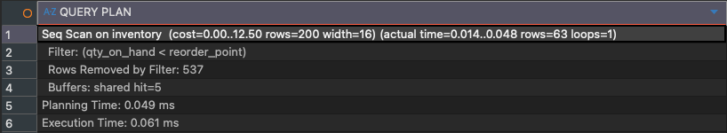 |

---

## Q8) 리뷰 4.5 이상 & 50개 이상 효자상품

**쿼리 의도**: 평균 평점 4.5 이상이면서 리뷰 수 50개 이상인, 반응이 좋고 리뷰도 많은 "효자상품"을 조회.

**튜닝 전 문제점**
상품마다 `AVG(rating)`, `COUNT(*)` 상관 서브쿼리를 `SELECT` 절과 `WHERE` 절에서 각각 반복 호출했다. 상품 수만큼 `reviews` 테이블을 반복 스캔하는 N+1 패턴이다.

**튜닝 내용**
- `reviews`를 `GROUP BY product_id`로 한 번에 집계하고 `HAVING AVG(rating) >= 4.5 AND COUNT(*) >= 50`으로 조건 필터
- `CREATE INDEX idx_reviews_product_cover ON reviews (product_id) INCLUDE (rating)` 커버링 인덱스 추가

**효과**: `reviews` 스캔이 1회로 감소하고, 커버링 인덱스 덕분에 힙 접근 없이 인덱스만으로 집계(Index Only Scan)할 수 있다.

| 구분 | 스크린샷 |
|---|---|
| 결과 확인 (튜닝 전/후 공통) | 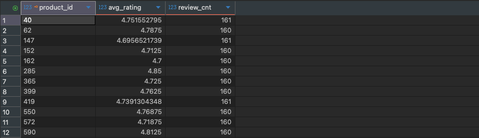 |
| 튜닝 전 EXPLAIN ANALYZE |  |
| 튜닝 후 EXPLAIN ANALYZE | 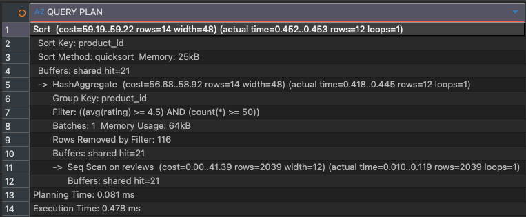 |

---

## Q9) 쿠폰 사용 영향 (쿠폰 사용 주문 vs 미사용 주문 평균금액)

**쿼리 의도**: 쿠폰을 사용한 주문과 사용하지 않은 주문의 평균 주문 금액을 비교.

**튜닝 전 문제점**
쿠폰 있음/없음 두 그룹을 각각 별도 쿼리로 작성한 뒤 `UNION ALL`로 합쳤다. 이 때문에 `orders`/`order_items` 조인을 두 번 반복 수행하게 된다.

**튜닝 내용**
- `CASE WHEN o.coupon_code IS NOT NULL THEN 'coupon' ELSE 'no_coupon' END`으로 그룹 라벨을 만들고, 한 번의 `GROUP BY`에서 두 그룹을 동시에 집계
- `CREATE INDEX idx_orders_coupon ON orders (coupon_code)` 추가

**효과**: 테이블 스캔이 1회로 줄어 두 그룹을 동시에 계산한다.

| 구분 | 스크린샷 |
|---|---|
| 결과 확인 (튜닝 전/후 공통) | 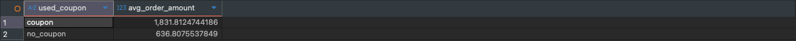 |
| 튜닝 전 EXPLAIN ANALYZE | 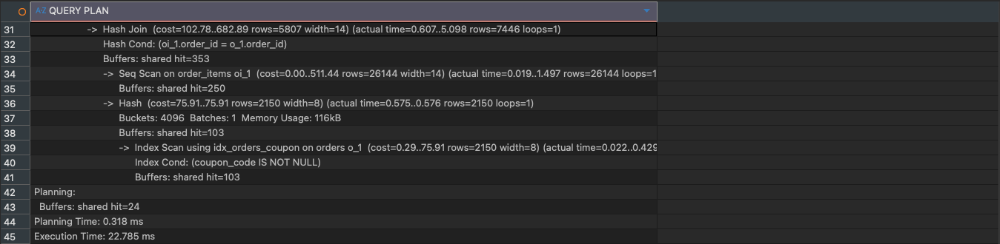 |
| 튜닝 후 EXPLAIN ANALYZE |  |

---

## Q10) 상위 1% 고객의 최근 60일 매출

**쿼리 의도**: 누적 매출 기준 상위 1% 고객을 가려내고, 이들의 최근 60일 매출을 조회.

**튜닝 전 문제점**
전체 고객 매출 계산, 백분위(`PERCENTILE_CONT(0.99)`) 계산, 최근 60일 매출 계산이 한 쿼리 안에 뒤섞여 있어, 최종적으로는 상위 1%에 들지 못하는 고객들까지 전부 조인·집계한 뒤에야 필터링되는 비효율이 있었다.

**튜닝 내용**
- `PERCENT_RANK() OVER (ORDER BY SUM(line_total) DESC)`로 상위 1% 고객 집합(`top_customers`)을 CTE로 먼저 확정
- 확정된 소수의 고객에 대해서만 최근 60일 매출을 다시 조회

**효과**: 최종적으로 필요한 소수 고객 집합만 재스캔하면 되므로, 처리해야 하는 데이터량이 대폭 감소한다.

*검증: `customer_id`가 대부분 1~30 사이로 나와야 정상 (seed 데이터의 heavy customer들).*

| 구분 | 스크린샷 |
|---|---|
| 결과 확인 (튜닝 전/후 공통) | 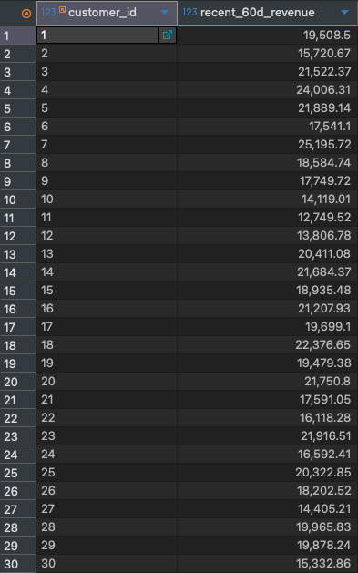 |
| 튜닝 전 EXPLAIN ANALYZE | 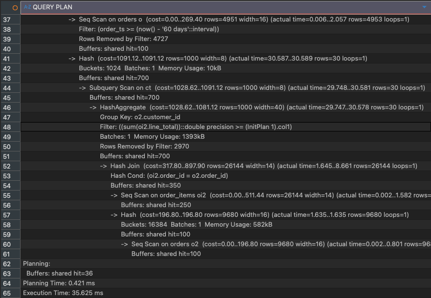 |
| 튜닝 후 EXPLAIN ANALYZE |  |

---

## 전체 튜닝 패턴 요약

| 패턴 | 해당 문항 |
|---|---|
| 인덱스 컬럼에 연산 적용 금지 → 원본 컬럼 비교 + 복합 인덱스 | Q1, Q3 |
| 상관 서브쿼리(N+1) → 윈도우 함수로 단일 스캔 전환 | Q4, Q6, Q8 |
| 반복 조회되는 집계를 Materialized View로 사전 계산 | Q2 |
| 불필요한 fan-out/중복 스캔 제거 (선집계, 서브쿼리 제거, UNION→CASE) | Q5, Q7, Q9 |
| 전체 스캔 후 필터링 → 대상 집합을 먼저 좁힌 뒤 재조회 | Q10 |
